# Guia do Projeto — Mapa de Vitória da Conquista

> O objetivo aqui é mapear **o que é cada parte e como elas conversam** —
> não os detalhes de implementação. Quando o "porquê" de alguma decisão importar,
> este guia aponta para [`DECISOES-TECNICAS.md`](./DECISOES-TECNICAS.md).

---

## 0. Onde mexer para...

| Quero... | Mexo em |
|---|---|
| Mudar a cor de um nível num tema | `src/app/globals.css` (o bloco do tema) |
| Mudar as paletas do seletor de cores | `src/lib/color/palette.ts` |
| Mudar espessura de traço ou nome de um nível | `src/config/levels.ts` |
| Mudar quais camadas começam ligadas | `src/config/levels.ts` (`DEFAULT_LAYER_TOGGLES`) |
| Ajustar altura, área ou o que vai em cada prédio | `scripts/prepare-buildings.mjs` (e rodar `npm run prepare-data`) |
| Ajustar zoom mínimo, LOD ou opacidade dos prédios | `src/config/buildings.ts` |
| Regenerar os prédios (nova release do Overture, dados do ETL mudaram) | `npm run prepare-data` e commitar `public/tiles/predios` (só baixa se precisar; `PREDIOS_FORCE=1` força) |
| Ajustar densidade, tipos ou aparência da vegetação | `src/config/vegetation.ts` |
| Ajustar cor, ondulação ou brilho da água | `src/config/water.ts` |
| Adicionar uma variável ao mapa de calor, ou um grupo novo ao menu Visualizações | `src/config/visualizacoes.ts` (`GRUPOS_VISUALIZACAO`) |
| Mudar as cores, o número de faixas ou a opacidade do mapa de calor | `src/config/visualizacoes.ts` (`MATIZES`, `CHOROPLETH_CLASSES`, `RAMPA_INICIO`, `CHOROPLETH_OPACITY`) |
| Mudar o cálculo das faixas ou da rampa de cores | `src/lib/map/choropleth.ts` |
| Mudar o que a ficha mostra | `src/components/panel/FeatureDetails.tsx` |
| Mudar o comportamento de clique/hover no mapa | `src/hooks/useMapLayerHandlers.ts` (Fase 3) ou `src/hooks/useMapInteraction.ts` |
| Mudar os dados de bairro/loteamento/setor | `dados/etl/etl.ipynb` (rodar e copiar `dados/etl/output/*` para `public/data/`) |
| Mudar rótulos e formatação da ficha | `src/config/indicadores.ts` e `src/components/panel/FichaSecoes.tsx` |
| Mudar visibilidade de camadas (bairro/loteamento/setor) | `src/hooks/map/use*Layer.ts` (Fase 3) |
| Adicionar um novo controle flutuante | `src/components/MapView.tsx` (é ele que posiciona todos) |

> ⚠️ **Nunca edite `src/components/ui/map.tsx`.** É código padrão da lib map-cn e MapLibre, baixado de um registro externo, e é sobrescrito quando reinstalado. 
> Toda customização do mapa é feita passando propriedades a partir do `MapView`.

**Nota sobre Fase 3 (refatoração de MapLayers):** A lógica que costumava estar toda em `MapLayers.tsx`
foi distribuída em hooks especializados. Para hooks de estado/interação, veja `useMapInteraction` e
`useMapLayerHandlers`. Para criação/visibilidade de camadas, veja `src/hooks/map/`.

---

## 1. O que é o o Projeto

É um **mapa interativo** da cidade de Vitória da Conquista. A tela é um mapa que
ocupa quase tudo, e sobre ele flutuam alguns controles.

O mapa mostra três níveis de divisão do território, do maior para o menor:

| Nível | O que é |
|---|---|
| **Bairro** | A maior divisão. É por onde a navegação começa. |
| **Loteamento** | Um recorte dentro de um bairro. |
| **Setor censitário** | A malha do IBGE, usada como camada de referência. |

Clicando num bairro, ele é enquadrado no mapa e uma ficha lateral mostra os
loteamentos que existem ali dentro. Três botões deixam ligar, por cima da área
selecionada, prédios, vegetação e água em 3D (seções 9, 10 e 11). O botão
"Visualizações" pinta o mapa como um **mapa de calor** de uma variável do Censo,
como densidade, renda ou esgoto (seção 12). Além disso, o
usuário pode buscar um lugar pelo nome, ligar e desligar cada nível, e trocar entre
três temas visuais (claro, escuro e "antigo", que imita um mapa de pergaminho).

Um detalhe importante de contexto: **o projeto é um MVP**. Ainda não existe banco de
dados — os dados vêm de arquivos, e alguns campos são inventados de propósito para
demonstrar a interface. A seção 5 diz exatamente quais.

---

## 2. Anatomia da tela


### Desktop

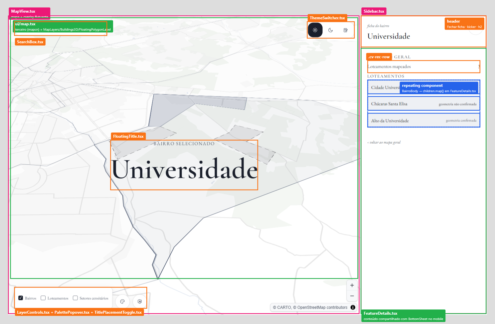

- **Rosa** — `MapView.tsx`, que envolve tudo, e `Sidebar.tsx`, o painel da direita.
- **Verde** — as áreas de conteúdo: o mapa em si (`ui/map.tsx`, com `MapLayers`,
  `Buildings3D` e `FloatingPolygonLabel` desenhando dentro dele) e `FeatureDetails.tsx`,
  o miolo da ficha.
- **Laranja** — os controles flutuantes: busca, troca de tema, título do que está
  selecionado e, no rodapé, os interruptores de camada, paleta e rótulo.
- **Azul** — um trecho que se repete: cada loteamento da lista é o mesmo bloco
  renderizado várias vezes.

### Mobile

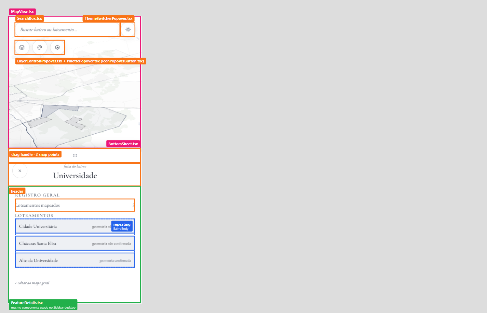

No celular a estrutura é a mesma, com duas diferenças: o painel lateral vira uma
**folha que sobe de baixo** (`BottomSheet.tsx`, arrastável, com duas alturas), e os
controles que no desktop ficam abertos viram **botões redondos que abrem um menu**
(os `*Popover.tsx`). O conteúdo da ficha, em verde na imagem, é literalmente o mesmo
componente nos dois casos.

### A árvore, em forma de diagrama

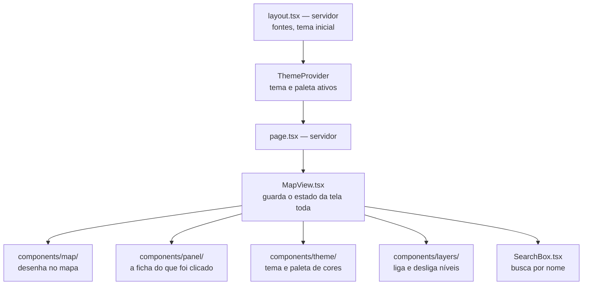

O ponto a guardar: **`MapView` é o centro**. Ele guarda o que está selecionado, o que
está sob o cursor e quais camadas estão ligadas, e distribui isso para todos os
outros. Os demais componentes quase não têm estado próprio — recebem tudo pronto.

### A ficha: FeatureDetails, Sidebar e BottomSheet

`FeatureDetails.tsx` é só o **conteúdo** da ficha — sem moldura de painel.
`Sidebar` (desktop/tablet) e `BottomSheet` (mobile) são duas molduras
diferentes ao redor dele: o `MapView` monta as duas **sempre**, e quem
decide qual aparece é CSS (`hidden md:block` / `md:hidden`), não uma
condição em JavaScript — assim redimensionar a janela pelo breakpoint não
remonta nada nem perde o estado de arraste da folha mobile.

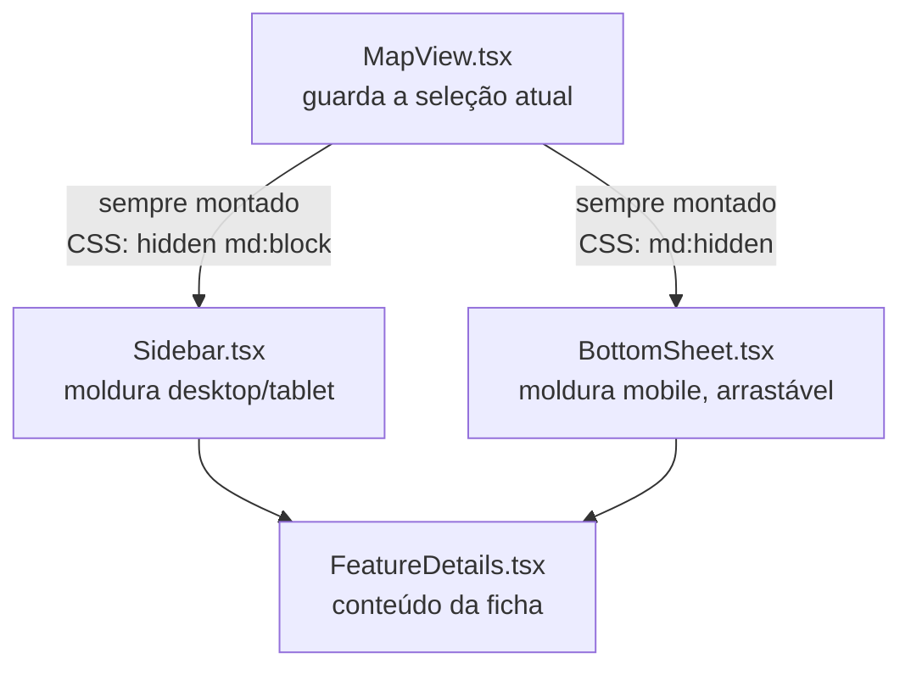

`FeatureDetails` é o mesmo componente nas duas pontas — o diagrama acima
representa as duas instâncias, cada painel monta a sua. A lógica de "voltar"
(‹ voltar ao mapa geral ou ‹ voltar para [bairro-pai]) é centralizada dentro
de `FeatureDetails`, decidindo se deve fechar a ficha ou navegar pro nível anterior.

---

## 3. Estrutura de pastas

```
src/
├── app/                  A página em si (App Router)
│   ├── layout.tsx          Moldura: fontes, tema inicial, ThemeProvider
│   ├── page.tsx            A única rota ("/"), que só renderiza o MapView
│   └── globals.css         Estilos e as cores dos três temas
│
├── components/           Tudo que aparece na tela
│   ├── MapView.tsx         O orquestrador (ver seção 2)
│   ├── SearchBox.tsx       A busca por nome
│   ├── buttons/            Controles flutuantes (refatorados em Fase 3)
│   │   ├── ToggleButton.tsx
│   │   ├── IconPopoverButton.tsx
│   │   ├── optionsList/    Camadas, visualizações (mapa de calor) e paleta
│   │   └── themeSwitcher/  Troca de tema
│   ├── map/                O que é desenhado no mapa
│   │   ├── MapLayers.tsx   Criação de camadas (refatorado em Fase 3)
│   │   ├── Buildings3D.tsx Prédios 3D
│   │   ├── Trees3D.tsx     Vegetação 3D (seção 10)
│   │   ├── Water3D.tsx     Água 3D (seção 11)
│   │   ├── ChoroplethLayer.tsx  Pintura do mapa de calor (seção 12)
│   │   ├── ChoroplethLegend.tsx Legenda do mapa de calor (seção 12)
│   │   └── FloatingTitle.tsx Rótulo no topo
│   ├── panel/              A ficha lateral (desktop) e a folha inferior (mobile)
│   ├── theme/              Tema (ThemeProvider)
│   ├── icons/              Ícones (lucide-react)
│   └── ui/                 ⚠️ Biblioteca externa de mapas — não editar
│
├── hooks/                Lógica reutilizável (buscar dados, ler o tema, etc.)
│   ├── useGeoIndex.ts    Índice de busca + dados brutos (4.2 ✅)
│   ├── useThemeTokens.ts Cores do tema
│   ├── useMapStyles.ts   Estilo do basemap
│   ├── useMapInteraction.ts Seleção/hover/preview (novo em Fase 3)
│   ├── useChoropleth.ts  Dados, faixas e cores do mapa de calor (seção 12)
│   ├── map/              Hooks de camadas do mapa (novo em Fase 3)
│   └── ... (mais utilitários)
├── lib/                  Funções de apoio, sem tela
│   ├── color/              Tema, paletas e conversão de cores
│   └── map/                Contas e utilidades de mapa
├── config/               Valores ajustáveis (quais níveis existem, prédios, vegetação, água, visualizações)
└── types/                Vocabulário de tipos compartilhado

public/data/              Os arquivos GeoJSON servidos para o navegador
scripts/                  Preparação dos dados (roda à mão, fora do site)
docs/                     Esta documentação
```

A divisão em `lib/color/` e `lib/map/` segue a mesma ideia das pastas de
`components/`: agrupar por assunto, para que o nome da pasta já diga do que se trata.

---

## 4. O que carrega primeiro

Uma dúvida comum: se o mapa é feito no navegador, o que o servidor manda?

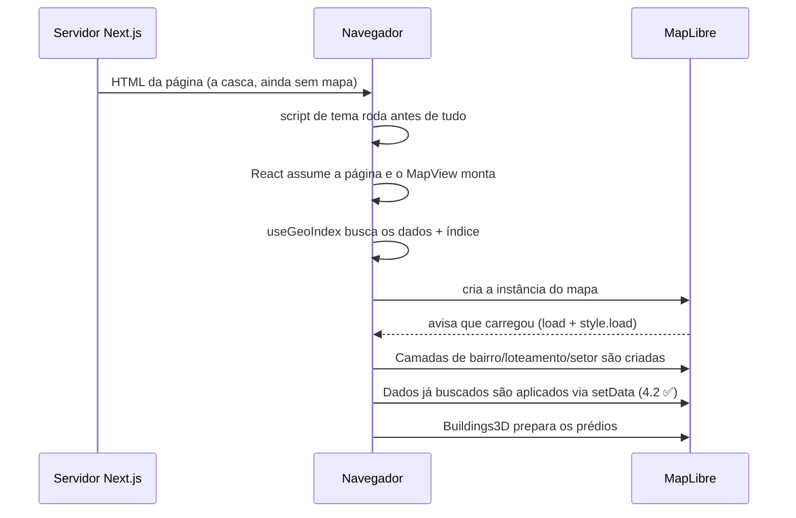

Dois detalhes valem nota:

O **script de tema** é uma injeção de JavaScript que o `layout.tsx` injeta e que roda
*antes* da página aparecer. Ele lê o tema que o usuário escolheu da última vez e já
aplica. Sem isso, quem usa o tema escuro veria um flash branco a cada carregamento (anti-FOUC).

As camadas **só são criadas depois** que o MapLibre avisa que terminou de carregar.
Por isso a ordem acima importa: tentar criar uma camada antes disso simplesmente
falha. O mesmo vale toda vez que o usuário troca de tema, porque trocar o tema
recarrega o mapa de fundo inteiro e apaga as camadas — que são recriadas em seguida.

**Mudança em Fase 3:** A lógica de `MapLayers` foi distribuída em 4 hooks especializados
(`useBairroLayer`, `useLoteamentoLayer`, `useSetorLayer`, `useGeoLayerStyles`), separando
criação de camadas (estrutura) de aplicação de dados/cores (semântica).

---

## 5. De onde vêm os dados

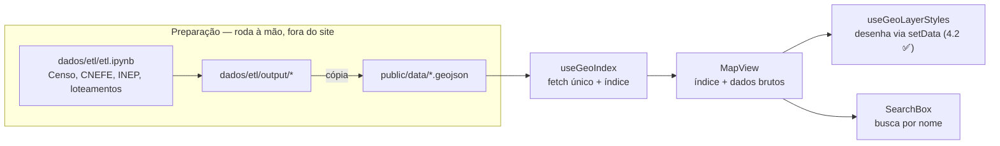

Os arquivos de `public/data/` (exceto `postes.json`) são o output do ETL em
`dados/etl/output/`, copiados sem alteração: `bairros_e_distritos.geojson`,
`loteamentos.geojson`, `setores.geojson`, `areas_ponderacao.geojson` e
`metadados.json`. O esquema de cada um está em `dados/etl/model/hierarquia_dados.md`.
Quando o ETL roda de novo, basta copiar os arquivos. Isso **não** roda junto com o
site: é um passo manual, feito quando o dado de origem muda.

O frontend lê as chaves do ETL direto (`nome`, `nm_bairro`, `tipo`, `is_reliable`…).
As áreas de ponderação não têm camada nem entram na busca: só aparecem como
indicadores na ficha do loteamento, cruzadas pelo `cd_ap`.

`npm run prepare-data` gera `postes.json` (`scripts/prepare-lamps.mjs`) e os tiles de
prédios (`scripts/prepare-buildings.mjs`, seção 9).

**Quando houver banco de dados, a cópia para `public/data/` deixa de ser necessária.**

No navegador, o hook `useGeoIndex` busca esses arquivos **uma única vez** e entrega
o resultado ao `MapView`: tanto o índice (para busca) quanto os dados brutos
(para desenhar no mapa). **Fase 3 (4.2):** eliminou a duplicação — `useGeoLayerStyles`
aplica os dados já fetchados ao MapLibre via `setData()`, em vez de deixar o MapLibre
rebuscar a URL.

Além desses arquivos locais, duas coisas vêm de fora, prontas:

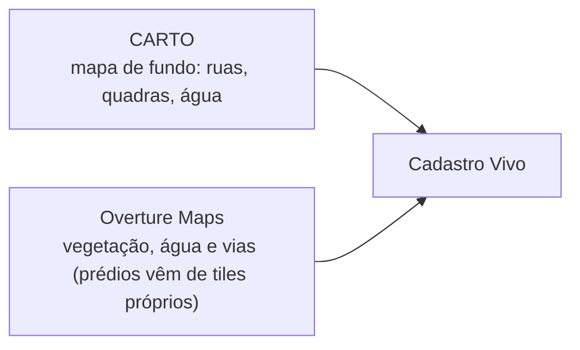

**O que é inventado ou aproximado (e por quê).** Sendo um MVP:
- `is_reliable` dos loteamentos vem do arquivo de entrada do ETL
  (`dados/etl/input/bairros_e_loteamentos/loteamentos.geojson`): marca as geometrias
  aproximadas na consolidação dos polígonos. Não é mais mock.
- Altura dos prédios é **MOCK explícito** (4.4 ✅)

Marcados no código com comentário `MOCK (MVP)`, saem quando existir fonte real.

---

## 6. O que acontece ao clicar num bairro

Este é o fluxo central da aplicação. Vale ler o diagrama junto com a ideia de que
**`MapView` é o único que guarda o estado** — todo o resto reage a ele.

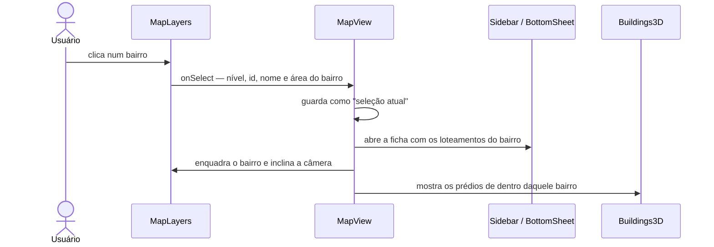

Repare que `MapLayers` **não decide nada**: ele avisa `MapView` do clique e volta a
esperar. Quem decide o que isso significa é o `MapView`, que atualiza seu estado; e
é a mudança desse estado que faz a ficha abrir, o mapa se mover e os prédios subirem.
Esse mesmo padrão se repete no hover e na busca.

Há uma regra de navegação embutida: o primeiro clique sempre seleciona o **bairro**,
mesmo que o cursor esteja sobre um loteamento. Só depois de estar dentro de um bairro
é que clicar num loteamento o seleciona. Isso dá uma hierarquia ("primeiro onde,
depois qual") em vez de saltos confusos.

---

## 7. Como funciona a busca

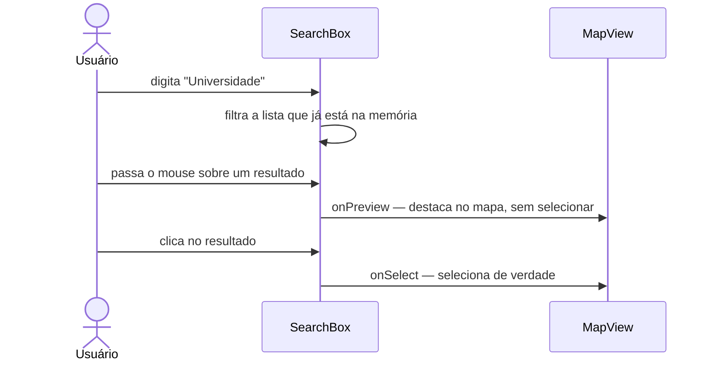

A busca não faz nenhuma chamada de rede: ela filtra a lista que `useGeoIndex` já
carregou (seção 6). Por isso é instantânea.

A diferença entre **prévia** e **seleção** é o que faz a busca parecer responsiva:
passar o mouse já mostra onde fica aquele lugar, sem abrir ficha nem mover o mapa;
só o clique confirma. Diferente do clique no mapa, a busca **pode ir direto a um
loteamento** sem passar pelo bairro — quem digitou o nome já disse o que queria.

---

## 8. Como tema e paleta pintam o mapa

Este é o caminho menos óbvio do projeto, e o que mais confunde quem chega. O truque
é que **as cores moram no CSS**, não no código do mapa.

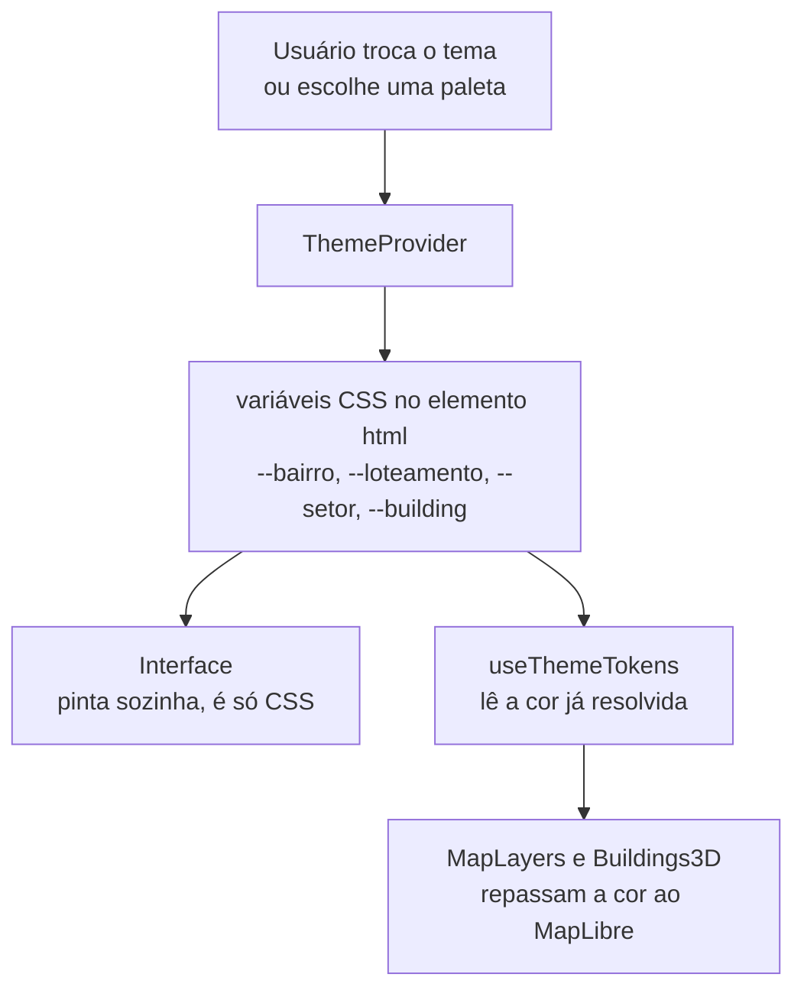

Quando o usuário troca de tema, o `ThemeProvider` marca o tema no elemento `html`, e
o `globals.css` já tem, para cada tema, o valor de cada cor. A interface inteira
muda sozinha a partir daí, porque é só CSS.

O mapa é o caso especial: o MapLibre **não entende variáveis CSS**, ele precisa
receber a cor final (`#a04540`). É exatamente isso que o `useThemeTokens` faz — lê a
cor que o navegador calculou e entrega o valor pronto para `MapLayers` repassar ao
mapa. É o que permite que o seletor de paleta mude a interface e o mapa juntos, sem
duas listas de cores em lugares diferentes.

---

## 9. Os prédios 3D

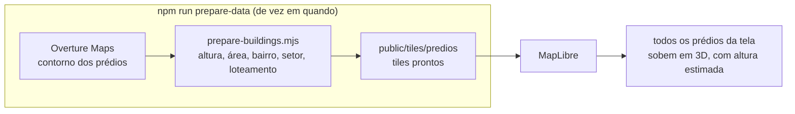

Os prédios vêm do Overture Maps, mas o site não lê o arquivo deles enquanto roda.
Um script baixa só o pedaço do município e calcula, para cada um dos ~190 mil
prédios, a altura estimada, a área e em qual bairro, setor e loteamento ele está. O
resultado vira um conjunto de arquivos prontos (*tiles*) em `public/tiles/predios/`,
de ~11 MB.

Esses arquivos **ficam no Git**, então o deploy não baixa nada. O script só baixa o
Overture de novo quando os dados do ETL mudam ou quando a versão usada fica mais de
90 dias atrás da mais nova; fora disso, `npm run prepare-data` termina em segundos.
Quando ele regenerar, é só commitar `public/tiles/predios`.

O mapa mostra **todos os prédios que estão na tela**: o MapLibre já só carrega os
pedaços visíveis, e a triangulação de cada pedaço roda uma vez, fora da thread
principal. Selecionar um bairro não recarrega prédios; a seleção aparece no contorno
e na ficha. Prédios muito pequenos só aparecem com o zoom bem
próximo, porque de longe seriam pontinhos ilegíveis (*level of detail*, ou LOD). Isso
também é filtro. A ficha mostra quantos prédios a área tem, número que vem pronto do
mesmo script.

---

## 10. Vegetação 3D

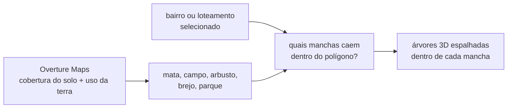

O botão "Vegetação 3D" liga árvores dentro do bairro ou loteamento em foco, na
mesma lógica de recorte dos prédios (seção 9). A diferença é a fonte: em vez do
contorno de edificações, vêm duas informações do Overture — **cobertura do
solo** (é mata? é campo aberto? é um brejo?) e **uso da terra** (é um parque?).
Cada mancha desse tipo vira um punhado de árvores sorteadas dentro dela, com
densidade diferente por tipo: uma mata fica bem mais cheia de árvores que um
campo aberto ou um parque, do jeito que seria na vida real.

Três detalhes que não são óbvios:

- **As árvores são desenhadas de verdade em 3D** — tronco e copa como formas
  sólidas, não um ícone plano. O MapLibre sozinho não sabe desenhar isso; o
  projeto usa uma engine 3D própria (Three.js) rodando *dentro* do mapa,
  compartilhando a mesma tela.
- **O sorteio das posições é sempre o mesmo** para o mesmo pedaço de terreno.
  Parece aleatório, mas é calculado a partir da forma da mancha — se fosse
  aleatório de verdade, as árvores "pulariam" de lugar toda vez que o mapa
  fosse redesenhado (ao arrastar ou dar zoom, por exemplo).
- **Árvore nunca nasce dentro d'água.** Antes de aceitar cada posição
  sorteada, o projeto confere se ela não cai em cima de um lago ou rio —
  importante porque mata e brejo às vezes encostam na beira da água nos
  próprios dados do Overture.

## 11. Água 3D

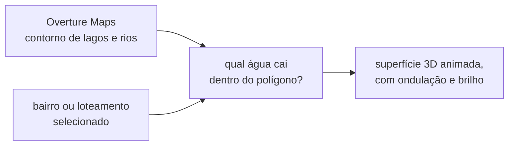

O botão "Água 3D" funciona igual ao de vegetação: mostra lagos, rios e lagoas
dentro do bairro ou loteamento em foco, também vindos do Overture. A diferença
é que a água é **animada** — ela ondula e brilha sozinha, sem o usuário
interagir, enquanto o toggle estiver ligado.

Esse efeito também é desenhado pela mesma engine 3D (Three.js): uma foto real
de água cobre a superfície, e uma segunda imagem (um "mapa de relevo" da
água) faz o brilho da luz se mover como se houvesse ondulação de verdade.

Um detalhe que parece estranho à primeira vista: a água é **opaca**, não
deixa nada por baixo aparecer. Isso é proposital — lagos grandes cruzam a
fronteira entre pedaços dos dados do mapa, e o mesmo trecho de água acaba
chegando duplicado; com transparência, o trecho duplicado ficava visivelmente
mais escuro (duas camadas semitransparentes por cima uma da outra), formando
uma linha feia bem no meio do lago. Deixando opaco, a duplicata desenha
exatamente a mesma cor por cima — sem esse problema.

---

## 12. Visualizações e mapas de calor

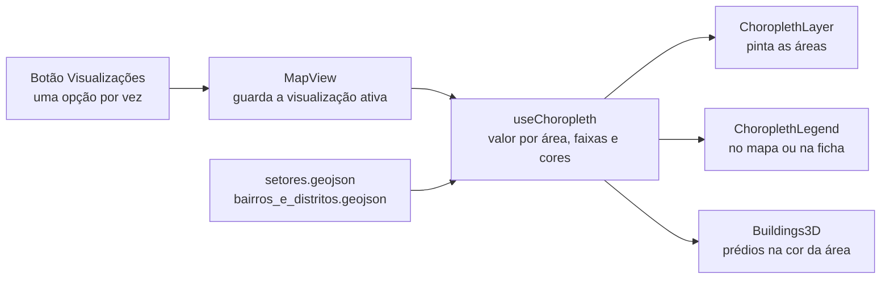

O botão "Visualizações" (ícone de mapa, ao lado de "Camadas" e "Paleta") abre um
menu organizado em grupos. Hoje existe um grupo, **Mapa de calor**, com três
variáveis:

| Variável | Pintada por | Cor |
|---|---|---|
| Densidade demográfica (hab/km²) | setor censitário | vermelho/laranja |
| Renda média do responsável | setor censitário | verde |
| Domicílios sem rede de esgoto | bairro e distrito | vermelho (carência) |

Só **uma visualização fica ativa por vez**, mesmo entre grupos diferentes. A
opção "Nenhuma" volta ao mapa normal.

Como funciona, em linhas gerais:

- **Cada área é pintada pelo próprio valor.** Os valores são divididos em 5
  faixas com a mesma quantidade de áreas em cada uma (quantis), e cada faixa
  ganha um tom. Tecnicamente é um *coroplético*, não um mapa de calor de pontos.
- **As cores partem da cor do terreno.** A menor faixa fica perto da cor base do
  mapa, e a maior é a cor forte da variável. No claro e no antigo, o valor alto é
  o mais escuro; no escuro, o valor alto é o mais claro e "acende".
- **Setor por padrão, bairro quando há sigilo.** O IBGE omite dados de setores
  muito pequenos. No esgoto, isso atinge 23% dos setores, então essa variável é
  pintada por bairro. Área sem dado fica **cinza**, nunca como zero.
- **A legenda acompanha a ficha.** No desktop, ela flutua ao lado dos botões e
  sobe para o topo da ficha quando a ficha está aberta. No celular, aparece só
  dentro da ficha.
- **Os prédios 3D entram no mapa de calor.** Cada prédio usa a cor do setor em
  que está. Se o setor estiver sob sigilo, usa a cor do bairro; se não houver
  nenhum dos dois, usa a cor normal de prédio do tema.

Os detalhes e os números medidos que sustentam essas escolhas (por que não
loteamento, por que quantis, a correção do esgoto) estão em
[`DECISOES-TECNICAS.md` §6](./DECISOES-TECNICAS.md#6--visualizações-e-mapas-de-calor).

---

## 13. Para saber mais

| Documento | Para quê |
|---|---|
| [`DECISOES-TECNICAS.md`](./DECISOES-TECNICAS.md) | O "porquê" das decisões: por que tal alternativa foi rejeitada, teoria de cor dos temas, armadilhas de manutenção |

